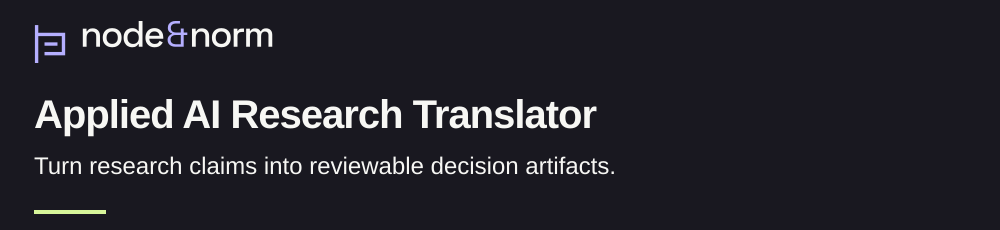

<h1>
<picture>
  <source media="(max-width: 600px)" srcset="assets/research/v1/banner-mobile-dark.svg">
  
</picture>
</h1>

[](LIMITATIONS.md) [](CITATION.cff) [](LICENSE)

What would let a reviewer trace a research claim into a bounded task and a recorded decision? This repository supplies source packs, artifact schemas and example runners for that question. [Translation method](TRANSLATION-METHOD.md).

[Policy reader: understand in 90 seconds](#research-in-90-seconds) · [Reviewer: inspect evidence and limits](docs/current-review.md) · [Engineer: run the checks](docs/reference-verification.md)

## At a glance

| | Current account |
| :--- | :--- |
| Purpose | Make the path from a research source to a decision record inspectable. [Method](TRANSLATION-METHOD.md) |
| Status | Research software and reference implementation with a limited demonstration corpus. [Limits](LIMITATIONS.md) |
| Evidence type | Source packs, schema checks, deterministic examples and recorded demonstration summaries. [Review guide](docs/current-review.md) |
| Version | v1.1.1, dated June 1, 2026 in the [citation record](CITATION.cff). |
| License | [Apache-2.0](LICENSE), with existing [attribution](NOTICE). |
| Cite | [Citation metadata](CITATION.cff) · [recorded DOI: 10.5281/zenodo.20478121](https://doi.org/10.5281/zenodo.20478121) |

## Research in 90 seconds

A research result needs a bounded interpretation before it can support an institutional decision. The translator proposes records for the source, extracted claim, permitted task, evaluation and human decision. Each record gives a reviewer something specific to examine. [Research rationale](RESEARCH-RATIONALE.md), [translation method](TRANSLATION-METHOD.md).

The contribution is a documented workflow and its reference code. A source pack groups the material used for one translation. Schemas define the required record structure. The model runloop asks a person to accept, override or reject a proposed category. [Packs](packs/), [schemas](schemas/), [human gate](runloop/src/human_gate.py).

The deterministic example runner follows a separate path using supplied inputs. Its outputs demonstrate artifact production and validation. Broader claims about source truth, reviewer quality or deployment benefit require additional evidence. [Runner](src/runner/run_task.py), [example inputs](examples/runs/), [limits](LIMITATIONS.md).

## Method in brief

The proposed sequence is: classify a source, extract bounded claims, define tasks, produce candidate artifacts and record a review decision. Implementation coverage varies between the model runloop and the deterministic runner. The [review guide](docs/current-review.md#method-and-implementation) identifies those boundaries alongside the [translation method](TRANSLATION-METHOD.md).

The [human-influence pack](packs/gradual_disempowerment_human_influence_2501a/README.md) connects this translation work to [Human Influence Telemetry](https://github.com/node-and-norm/human-influence-telemetry). That connection describes research lineage; the pack retains its evaluation-only boundary. [Pack record](packs/gradual_disempowerment_human_influence_2501a/README.md).

## Evidence and known limits

| Material | What it establishes | Remaining review |
| :--- | :--- | :--- |
| Source packs | Declared claims, tasks and evidence locations. [Packs](packs/) | Source fidelity and complete provenance require passage-level checks. [Review guide](docs/current-review.md#source-and-result-limits) |
| Deterministic examples | Supplied inputs can produce structured outputs. [Example runner](scripts/run_examples.sh) | General performance and institutional effects remain outside these examples. [Limits](LIMITATIONS.md) |
| Demonstration records | Saved summaries and manifests describe selected runs. [Demo records](docs/demo-runs/) | Raw run artifacts and any measured benefit need separate inspection. [Review guide](docs/current-review.md#source-and-result-limits) |
| Human gate | The interactive path collects accept, override or reject. [Code](runloop/src/human_gate.py) | The code permits empty notes and free-text overrides. Reviewer competence and evidence quality need separate assessment. [Code](runloop/src/human_gate.py), [limits](LIMITATIONS.md) |

## Reproduce the checks

The [verification guide](docs/reference-verification.md) gives exact commands, the Python environment and expected output. It runs schema checks and deterministic examples in a disposable copy. The example script writes run directories; reusing an identifier can replace files. [Example script](scripts/run_examples.sh), [runner](src/runner/run_task.py), [logger](runloop/src/logger.py).

## AI assistance and human review

The existing disclosure identifies AI assistance in research, drafting, documentation, schema design, repository organization, validation scripts and diagram planning. It assigns final responsibility to the author. A responsibility statement leaves the extent of completed source verification to the supporting review record. [AI disclosure and review limits](LIMITATIONS.md).

Codex prepared this navigation draft and its verification guide from repository files. Human approval of this presentation and independent verification of the underlying research remain separate review tasks. [Current review scope](docs/current-review.md).

## Cite the software

This entry renders the existing preferred citation in [CITATION.cff](CITATION.cff). The earlier README links a different Zenodo identifier. Both records remain preserved for metadata reconciliation. [Citation boundary](docs/current-review.md#citation-boundary).

```bibtex
@software{banasihan2026translator,
  author = {Banasihan, Mark Julius},
  title = {Applied AI Research Translator: A Governed Research-to-Decision Translation System},
  year = {2026},
  month = jun,
  version = {1.1.1},
  doi = {10.5281/zenodo.20478121},
  url = {https://github.com/node-and-norm/applied-ai-research-translator},
  note = {Released June 1, 2026}
}
```

<details>
<summary>Full technical history and earlier navigation</summary>

The [prior README](README-2026-11-03.md) preserves the complete entry at [audit commit 4e5d742](https://github.com/node-and-norm/applied-ai-research-translator/tree/4e5d742378dd2fecbafd525eeb9754c975b83aa0). Its claims and commands retain their historical scope. Use the [current review guide](docs/current-review.md) for implementation limits and the [verification guide](docs/reference-verification.md) for the bounded checks.

- [Governance model](GOVERNANCE-MODEL.md)
- [Traceability specification](TRACEABILITY.md)
- [Change history](CHANGELOG.md)
- [Contribution guidance](CONTRIBUTING.md)

</details>
